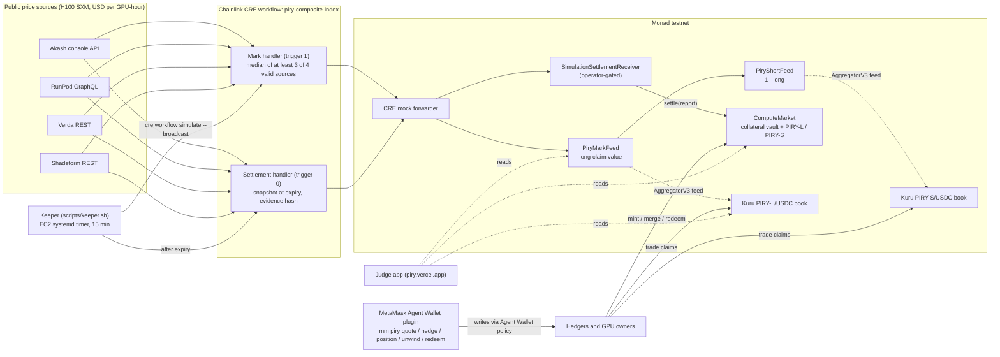

# Piry

Capped, collateralized GPU-price claims on Monad: trade them on Kuru order books, settled by a Chainlink CRE workflow.

[](LICENSE)
[](foundry.toml)
[](#verification)
[](#deployed-contracts-and-sponsor-integrations)
[](#chainlink-cre)
[](#kuru)

**Live app: [piry.vercel.app](https://piry.vercel.app)** · Built by [cassxbt](https://github.com/Cassxbt) · Monad Metropolis hackathon

[Overview](#overview) · [How it works](#how-it-works) · [Deployed contracts and sponsor integrations](#deployed-contracts-and-sponsor-integrations) · [Piry H100 Composite](#piry-h100-composite-the-index) · [Real vs simulated](#what-is-real-and-what-is-simulated) · [Verification](#verification) · [Run it yourself](#run-it-yourself)

## Demo

- **Live product:** [piry.vercel.app](https://piry.vercel.app) reads Monad testnet directly, no wallet needed: the live index and mark history, the Kuru PIRY-L and PIRY-S order books, an exposure calculator, and an Evidence page that rebuilds the accepted and refused settlement ledger from on-chain receipts.
- **Full lifecycle on-chain, in minutes:** the fast-demo series ran mint, mark, refused bad data, CRE settlement, refused replay and redeem on Monad testnet. Every step is a transaction below ([jump to it](#fast-demo-series-full-lifecycle-on-chain)).
- **Live series settles during judging:** the H100 series settles on **2026-10-19 12:00 UTC** and anyone can watch the settlement land on-chain.

<!-- TODO: Add the demo video link (project walkthrough and the 2-minute CRE simulation video) once recorded -->

## Overview

Quotes for the same H100 differ by 25 to 35 percent between providers, and prices move, so teams that rent H100s by the hour (inference startups on fixed-price plans, AI agents that pay per job) carry that risk unhedged. Owners of GPUs and lenders against GPU collateral carry the opposite risk. There is no tradable, on-chain instrument for it.

Piry mints **paired long and short ERC-20 claims** on a GPU-hour price index inside a fixed price band. The two claims always pay out exactly the collateral deposited, so the contract is fully collateralized and the loss is capped at the band by design. Each claim trades on its own **Kuru** order book; a **Chainlink CRE** workflow computes the index from four public GPU price sources and settles the market on-chain.

It is a cash-settled capped hedge, not a guaranteed GPU bill: it does not reserve compute, deliver hardware or reimburse invoices.

## Features

- **Paired, fully collateralized claims** — 1 USDC of collateral mints 1 PIRY-L plus 1 PIRY-S; `mergePairs` returns the collateral 1:1 at any time, before or after settlement.
- **Capped payout by construction** — a long pays `clamp((index - 2.50) / 2.00, 0, 1)` USDC, a short pays the complement; the live band is $2.50 to $4.50 per GPU-hour.
- **Real order books** — PIRY-L/USDC and PIRY-S/USDC are Kuru V2 markets on Monad testnet, with on-chain AggregatorV3 price feeds (`PiryMarkFeed`, `PiryShortFeed`) built for them.
- **Multi-source index** — the Piry H100 Composite takes the median of Akash, RunPod, Verda and Shadeform, needs at least 3 of 4 valid, and records every failure in hashed evidence.
- **Auditable settlement** — a CRE workflow settles once; replays and bad data are refused, and an evidence hash on-chain commits to the exact source values.
- **Liveness backstop** — if no valid report arrives within 7 days of expiry, anyone can call `settleFallback()` to settle at the band midpoint. No holder is ever locked.
- **Agent-ready** — a MetaMask Agent Wallet plugin lets an AI agent size, buy, track, unwind and redeem a hedge inside a spending cap.
- **509 tests in `make verify`** — 132 Solidity (fuzz and adversarial-token suites), 9 Python, 248 Node and 120 Bun workflow tests.

## How it works

1. **Mint:** deposit USDC into `ComputeMarket`, receive equal PIRY-L and PIRY-S.
2. **Trade:** buy or sell either claim on its Kuru order book. A hedger buys PIRY-L; a GPU owner buys PIRY-S.
3. **Mark:** every 15 minutes a keeper runs the CRE mark handler, which writes the composite index (mapped through the band) to `PiryMarkFeed`; `PiryShortFeed` serves `1 - long`. Both are AggregatorV3 feeds, the price-source format Kuru asked for.
4. **Settle:** after expiry the CRE settlement handler snapshots the composite, ABI-encodes a report bound to the chain, market, index id, spec hash and period, and delivers it to the receiver, which calls `settle` exactly once.
5. **Redeem:** burn claims for their fixed payout. If CRE never settles, `settleFallback()` opens 7 days after expiry.

Payout for lower bound `L`, upper bound `U`, settlement price `P` and `q` claims:

```text
long  = floor(q * clamp(P - L, 0, U - L) / (U - L))
short = floor(q * clamp(U - P, 0, U - L) / (U - L))
```

Example from the fast-demo series (band $2 to $4, settled at $2.658755): 1,000 long redeemed for 329.3775 and 1,000 short for 670.6225, summing to the 1,000 deposited.

## Architecture



## Tech stack

| Component | Technology |
|---|---|
| Contracts | Solidity 0.8.31 (Osaka), OpenZeppelin 5.4.0, Foundry |
| Settlement and index | Chainlink CRE workflow (TypeScript, `@chainlink/cre-sdk` 1.23.0, CRE CLI 1.38.0) |
| Trading | Kuru V2 order books on Monad testnet (chain 10143) |
| Agent wallet | MetaMask Agent Wallet plugin (oclif, viem, `mm` >=6.2.0 <8.0.0) |
| App | Vite, React, viem, wagmi, Recharts; deployed on Vercel |
| Tooling | Bun, Node.js 22, Python 3 (preflight checker), Make |

## Deployed contracts and sponsor integrations

All addresses are Monad testnet (chain 10143), explorer [testnet.monadscan.com](https://testnet.monadscan.com). Machine-readable copy: [`deployments/monad-testnet.public.json`](deployments/monad-testnet.public.json).

### Live series: Piry H100 Composite, settles 2026-10-19 12:00 UTC

Band $2.50 to $4.50, 6 decimals, max report age 6 h, fallback delay 7 days. Collateral is Kuru Test USDC.

| Contract | Address | Deploy tx |
|---|---|---|
| `ComputeMarket` | [`0xe3Aab2…d22538`](https://testnet.monadscan.com/address/0xe3Aab2F36601cEC8d217DA5497fC3FE00ed22538) | [`0xd0896578…aa71ce`](https://testnet.monadscan.com/tx/0xd08965787f8faec563ab4d31ebb50884503300dc468fcdb1a0e2bd7a79aa71ce) |
| `SimulationSettlementReceiver` | [`0x6B1556…29a3A1`](https://testnet.monadscan.com/address/0x6B15565bFC329edEC5ca2BAE96fB792C0429a3A1) | [`0x723c3154…456dc5`](https://testnet.monadscan.com/tx/0x723c31546d9456686425581e433bd7a8321ae163837bcdc9894d94dd9f456dc5) |
| `PiryMarkFeed` (long-claim value, AggregatorV3) | [`0xE4B792…0EbE5e`](https://testnet.monadscan.com/address/0xE4B79233F8ac4804BABfD6bd065aA6596b0EbE5e) | [`0xab2f28d3…12f43f`](https://testnet.monadscan.com/tx/0xab2f28d36302d6e1cc68586558fd9daaa44baa990cb25b81c5eef808a412f43f) |
| `PiryShortFeed` (1 - long, AggregatorV3) | [`0xd97bd7…0e2f80`](https://testnet.monadscan.com/address/0xd97bd777304bbf14d713c5498951da52d50e2f80) | [`0x6325878e…4094fc`](https://testnet.monadscan.com/tx/0x6325878ea606da63fd570c4a1baf6645a199069fa463ea6bb713295ab74094fc) |
| PIRY-L claim | [`0x7D4B13…5Ef997`](https://testnet.monadscan.com/address/0x7D4B1319648B1f2478495Dcce10313Cd045Ef997) | created by `ComputeMarket` |
| PIRY-S claim | [`0xF3ACA8…820d48`](https://testnet.monadscan.com/address/0xF3ACA854B4e0626CDedd391eC1396DBde6820d48) | created by `ComputeMarket` |
| Kuru Test USDC (collateral) | [`0xA402B4…96fEF1`](https://testnet.monadscan.com/address/0xA402B424f392EAA05DBc8779e4502A1F6A96fEF1) | Kuru |

### Kuru

| Item | Address or tx |
|---|---|
| PIRY-L/USDC market | [`0xe2393d5f15523931e59f340cffebcde30fa7db1a`](https://testnet.monadscan.com/address/0xe2393d5f15523931e59f340cffebcde30fa7db1a) (created [`0x36d3b9c3…98c5fb`](https://testnet.monadscan.com/tx/0x36d3b9c38e04892e39dd90ee7e2c5cff81d96f8a8d50916e8a106aa03898c5fb)) |
| PIRY-S/USDC market | [`0xd93db02c88d645e669a3965cd46e72cca137f193`](https://testnet.monadscan.com/address/0xd93db02c88d645e669a3965cd46e72cca137f193) (created [`0x13f5f46e…b9a976`](https://testnet.monadscan.com/tx/0x13f5f46ef7cdce9a15d8534449e0f471b6738a49712dc2959e690f42cab9a976)) |
| Kuru V2 Router / AccountCore | [`0xf75A75…12947E`](https://testnet.monadscan.com/address/0xf75A7529b83941e001d7D9bc113A73C92112947E) / [`0xdbaaDe…f78038`](https://testnet.monadscan.com/address/0xdbaaDe7B42c95399bb1E9614D51B5B9e2cf78038) |
| Seeding: mint 8,000 pairs | [`0x8baac099…ed254c`](https://testnet.monadscan.com/tx/0x8baac09956e177cb73531eea9680b9794497442a468b333ad4b654b9abed254c) |
| Seeding: deposit PIRY-L / PIRY-S / USDC (11,997.02) | [`0x4f2e58e3…2c9e97`](https://testnet.monadscan.com/tx/0x4f2e58e364245430595925c4fbb83bb4a661ff463a28da0a92a8e7bbae2c9e97) / [`0x06a202b6…49a321`](https://testnet.monadscan.com/tx/0x06a202b66e1136a23cc952e9c33ce27a784c2cd3e825c895794cf36f2749a321) / [`0x078bc07c…92df14`](https://testnet.monadscan.com/tx/0x078bc07ce02e7d762a381ce20299b017c1df5e819db7f715a15b50cf8d92df14) |
| Seeding: post orders PIRY-L / PIRY-S | [`0xb075423c…efe6ae`](https://testnet.monadscan.com/tx/0xb075423c9858c9648e5f97a00c46383ef0229a6aec7d99b49add0c1f51efe6ae) / [`0x1d5527f9…d81160`](https://testnet.monadscan.com/tx/0x1d5527f9c3ed7d7d81618fbab30ab89e1c582a82ea56c25b2496efbbc0d81160) |

Kuru deployed both markets for us from the claim token addresses Piry supplied; Piry built the two AggregatorV3 feeds Kuru asked for. Kuru's withdrawal limiter prices PIRY-L and PIRY-S through Kuru adapters that wrap these two feeds, and rejects prices older than 1,800 s, so the keeper keeps the mark under 20 minutes old. Params: tick 0.0001, min notional 1 USDC, taker 0.07 percent, maker 0.04 percent. Each book was seeded with 10 resting team orders (5 bids, 5 asks, 2 to 6 percent around fair value).

### Chainlink CRE

| Item | Detail |
|---|---|
| Workflow | `piry-composite-index` ([`workflow/`](workflow/)): two cron handlers, **settlement** (trigger 0) and **mark** (trigger 1), sharing one validation and encoding path |
| Index | Composite of four live HTTP sources, per-source consensus, median rule, evidence hash (see [the index](#piry-h100-composite-the-index)) |
| Delivery | `cre workflow simulate --broadcast` through the CRE mock forwarder [`0xB9F79d…eAd192`](https://testnet.monadscan.com/address/0xB9F79d863261869B234c481D1f9A7af84AeAd192) into the operator-gated receiver |
| Live marks | Run by the keeper every 15 minutes; rounds visible on [`0xE4B792…0EbE5e`](https://testnet.monadscan.com/address/0xE4B79233F8ac4804BABfD6bd065aA6596b0EbE5e) |
| Fast-demo settlement | [`0x44b935ac…718338`](https://testnet.monadscan.com/tx/0x44b935ac592035426b2cf07ecacf53b5c824e731a9b32f3ac3126ae60d718338): price $2.658755, forwarder `ReportProcessed.result = true` |
| Refused replay | [`0x66ebd575…42435d`](https://testnet.monadscan.com/tx/0x66ebd575d1441cadfcfe5a29d9f904c8005ab52081080c7405ca3a0e2f42435d): forwarder `result = false`, receiver reverted `AlreadySettled`, state unchanged |
| Reproduce without keys | `make cre-simulate` (see [Run it yourself](#run-it-yourself)) |

### MetaMask Agent Wallet plugin

[`plugins/metamask-piry/`](plugins/metamask-piry/README.md) adds `mm piry quote | hedge | position | unwind | redeem` for an `mm` Agent Wallet. The plugin holds no key: every write goes through the wallet executor, so MetaMask policy, threat scanning and 2FA apply. Spending caps, slippage floors and on-chain market checks run before anything is proposed. The live Kuru PIRY-L and PIRY-S markets are built in as defaults; `mm piry quote` against `mm` 7.1.0 reproduced index 3.4085 from the feed and from the four sources. 51 offline tests (plus 4 live read-only).

### Fast-demo series: full lifecycle on-chain

A synthetic-index series with 60-second slots, band $2 to $4, run end to end on Monad testnet (collateral `PiryTestUSD`).

| Step | Transaction |
|---|---|
| `ComputeMarket` / receiver / feed | [`0xb71f79…E0004a`](https://testnet.monadscan.com/address/0xb71f79e990629aD3d0aB8a3fd2A8F8a21FE0004a) / [`0x43259A…63ee39`](https://testnet.monadscan.com/address/0x43259Ac2952ae1583BDF0DC4756Eb86ec963ee39) / [`0x110Daf…ca9624`](https://testnet.monadscan.com/address/0x110Daf63811F8F2b50aC01a8Ab85fb9B20ca9624) |
| Mint 1,000 pairs | [`0x8c1c5446…d6e85d`](https://testnet.monadscan.com/tx/0x8c1c5446bf088b10d0b0b7015ed8f04b2879873096255ff6be7b6bde79d6e85d) |
| CRE mark, index 2.7436 to long value 0.3718 | [`0x818bb3d6…e263a5`](https://testnet.monadscan.com/tx/0x818bb3d66767f4c47a160e068d934b405e1e6cf9c7b001a11ff1b80993e263a5) |
| Bad data (duplicate slot): refused by the workflow before any write | no transaction; `settled()` stayed false |
| CRE settlement at $2.658755 | [`0x44b935ac…718338`](https://testnet.monadscan.com/tx/0x44b935ac592035426b2cf07ecacf53b5c824e731a9b32f3ac3126ae60d718338) |
| Replay refused (`AlreadySettled`) | [`0x66ebd575…42435d`](https://testnet.monadscan.com/tx/0x66ebd575d1441cadfcfe5a29d9f904c8005ab52081080c7405ca3a0e2f42435d) |
| Redeem 1,000 long, 329.3775 | [`0x829cf643…be9097`](https://testnet.monadscan.com/tx/0x829cf6434f441258da3799bfcdf6ecbe621178bdd3e1f9bc4685e38d8dbe9097) |
| Redeem 1,000 short, 670.6225 | [`0xe693ee80…76b84f`](https://testnet.monadscan.com/tx/0xe693ee80331f3689355fcd8db966af3e5e22404cca6e798069111bdc4e76b84f) |

After full redemption `collateralLocked` was 0 and the mark feed's final round equalled the settled long value (0.3293775).

## Piry H100 Composite: the index

The USD price of one H100 SXM GPU-hour, computed inside the CRE workflow from four public APIs. Endpoints and rules are bound into the series `specHash`, so config cannot redirect a source.

| Source | Endpoint | Rule |
|---|---|---|
| Akash | `console-api.akash.network/v1/gpu-prices` | nvidia / h100 / 80Gi / SXM5, `weightedAverage`, at least 2 providers |
| RunPod | `api.runpod.io/graphql` | `NVIDIA H100 80GB HBM3`, 1 GPU, on-demand price |
| Verda | `api.verda.com/v1/instance-types` | `1x H100 SXM5 80GB`, on-demand |
| Shadeform | `api.shadeform.ai/v1/instances/types` | H100 SXM5, 1 GPU, at least 4 clouds, Verda excluded to avoid double counting |

- **Median rule:** the index is the median of valid sources. With 4 valid it is the floored mean of the two middle values; with 3 it is the middle one. Example, 13 Oct: Akash 2.73, RunPod 2.69, Verda 4.087, Shadeform 4.17 gives **3.4085**.
- **Quorum:** at least 3 of 4 sources must be valid, otherwise the workflow fails closed and writes nothing.
- **Failure codes:** a failed source is kept in the evidence with a fixed code, never free text: `http-status`, `response-too-large`, `invalid-response`, `outside-sanity-bounds`, `below-minimum-count`, `unavailable-or-no-consensus`.
- **Sanity bounds:** each source value must sit between $0.50 and $20.00 per GPU-hour.
- **Evidence:** the canonical JSON of all four entries plus the methodology (`composite-median-v1`) and `specHash` is keccak256-hashed; the hash goes on-chain with every report and the app re-derives it in the browser.
- **Settlement:** a snapshot at expiry. The snapshot minute must be at or after `periodEnd` and inside the 6-hour publication window.

**Licensing:** this is a hackathon index built from public no-auth endpoints. Akash's console API is Apache-2.0; our licensing review rated RunPod and Shadeform uncertain for index use and did not separately review Verda, so Piry claims no production data rights. The production path is licensed or provider-signed price data swapped into the same four-source slots, plus the strict `SettlementReceiver` below. Source prices differ by 25 to 35 percent, which is why the median is used instead of a single vendor.

## What is real and what is simulated

| Piece | Status |
|---|---|
| Contracts on Monad testnet, claims, vault, redeem | **Real**, deployed and exercised on-chain (addresses above) |
| Kuru markets and order books | **Real** Kuru V2 markets created by Kuru; **liquidity is team-seeded**, so fills are test activity, not organic demand |
| Index data | **Real** live prices fetched from the four public APIs at run time |
| CRE workflow | **Real** CRE SDK code compiled and executed by the CRE CLI. Run via **CLI simulation with `--broadcast`**, not a DON: a single-node simulator, no multi-node consensus |
| Settlement delivery | Goes through the CRE **mock forwarder** into `SimulationSettlementReceiver`, which accepts a call only from that forwarder **and** from the configured operator (`tx.origin`). Authenticity rests on the operator key, not DON signatures. DON deployment needs Chainlink commercial terms, which are in progress |
| Production receiver | `SettlementReceiver` is built and tested (immutable forwarder, workflow id, 64-byte metadata check). It is **not** deployed on the live series |
| Keeper | A script on a single EC2 host runs the 15-minute marks and the settlement; it is a convenience, not a decentralized network |
| MetaMask plugin writes | Tested against a calldata-decoding chain simulator; reads are live. Not yet run through a real Agent Wallet |
| Network and funds | **Testnet only**, test tokens, no real value, unaudited |

## Verification

`make verify` (run 13 Oct 2026, exit 0):

| Suite | Result |
|---|---|
| Solidity (Foundry, incl. fuzz and adversarial-token suites) | 132 passed |
| Python (Kuru preflight checker) | 9 passed |
| Workflow, Node test runner | 248 passed |
| Workflow, Bun runtime tests | 120 passed |
| Plugin (`npm test` in `plugins/metamask-piry`) | 51 passed, 4 live tests skipped |
| App (`npm test` in `app`, vitest) | 103 passed at last recorded run |

Also: `make settlement-proof` runs validated data to report to receiver to settlement to redemption on a loopback Anvil, including duplicate data, a wrong-chain report and replay. A green CLI run is never treated as settlement; outcomes are read from the `Settled` event and contract state.

## Run it yourself

Requires Node.js 22, Bun, Python 3, Make and Foundry (verified with Foundry 1.5.1, Bun 1.3.10).

```bash
git clone https://github.com/Cassxbt/piry && cd piry
npm ci --ignore-scripts
forge build
make verify          # 509 tests, offline, no keys
```

Reproduce the CRE run without a wallet or funds (needs the [CRE CLI](https://docs.chain.link/cre) 1.38.0 and a free `cre login`, or `CRE_API_KEY`; no private key, no `--broadcast`, no transaction):

```bash
make cre-simulate
```

This fetches the four live sources, computes the composite and builds the mark report for the live series, using [`workflow/config.composite.live.json`](workflow/config.composite.live.json) (the live receiver, market and feed addresses, band terms, gas limits 300000 settle / 220000 mark). Expected output ends with `COMPOSITE mark simulation: composite-median-v1; price=3408500; slots=4; ...` (3408500 is $3.4085 on 13 Oct; yours tracks the live sources) and `Workflow Simulation Result`. Without `--broadcast` nothing is written on-chain; the CLI also prints an "unconfirmed, not authenticated" note on purpose.

More targets:

| Command | What it does |
|---|---|
| `make settlement-proof` | Local settlement proof on a temporary Anvil (synthetic data, mock transport) |
| `make preflight` | Read-only Kuru V2 baseline checks on Monad testnet |
| `make deploy-local` | Deploy a series to a local Anvil |
| `make seed-kuru` / `make test-trades` | Dry-run by default; real testnet needs `NETWORK=monad-testnet DRY_RUN=0 CONFIRM=1` and a funded key |
| `cd app && npm ci && npm run dev` | Run the judge app locally |

Try the MetaMask plugin (read-only works before login):

```bash
cd plugins/metamask-piry && npm ci && npm run build
mm config set experimentalPlugins true && mm config set experimentalAllowUnverifiedInstalls true
mm plugins install "file:$PWD" --accept-permissions
mm piry quote --gpu-hours 500 --sources
```

### Configuration

Nothing is required for `make verify` or `make cre-simulate`. Optional variables:

| Variable | Description | Required |
|---|---|---|
| `DEPLOYER_PRIVATE_KEY` | Funded testnet key for `deploy-testnet`, `seed-kuru`, `test-trades` | Real testnet writes only |
| `CRE_ETH_PRIVATE_KEY` | Signer for `cre workflow simulate --broadcast` | Broadcast only |
| `CRE_API_KEY` | Non-interactive CRE CLI auth (alternative to `cre login`) | Optional |
| `MONAD_TESTNET_RPC` | Override the public RPC `https://testnet-rpc.monad.xyz` for deploy scripts | No |
| `PIRY_KURU_MARKET` / `PIRY_KURU_SHORT_MARKET` | Override the built-in Kuru PIRY-L / PIRY-S books in the plugin | No |
| `PIRY_RPC_URL` | Plugin read RPC (https or loopback) | No |

Never commit `.env*` files; the repository ignores them.

## Repository layout

| Path | Contents |
|---|---|
| `contracts/` | `ComputeMarket`, `ClaimToken`, `PayoutMath`, `SettlementReceiver`, `SimulationSettlementReceiver`, `PiryMarkFeed`, `PiryShortFeed`, `PiryTestUSD` |
| `test/` | Foundry tests: payout math, market, adversarial tokens, fallback, receivers, feeds |
| `workflow/` | CRE workflow: settlement and mark handlers, composite index, validation, delivery, configs |
| `scripts/` | `deploy.ts`, `seed-kuru.ts`, `test-trades.ts`, `keeper.sh`, `settlement-proof.ts`, `preflight.py` |
| `plugins/metamask-piry/` | MetaMask Agent Wallet plugin and agent skill |
| `app/` | Judge web app (Vite + React) |
| `deployments/` | Public deployment record and example series configs |

## Security and limitations

- **Testnet prototype, unaudited.** No real funds, no production-readiness claim.
- **Operator-gated settlement.** On the live series the operator key can submit the settlement report. The strict `SettlementReceiver` (forwarder plus workflow id) is the production design; the 7-day permissionless `settleFallback()` bounds the damage of a stalled oracle but is itself a midpoint settlement.
- **Data trust.** Source checks verify shape, units and bounds, not truth. The four sources are unlicensed public endpoints and thin for H100 SXM (Akash has few providers).
- **Basis risk.** The index tracks listed on-demand prices; a hedger's actual bill can differ. Payouts are capped at the band.
- **Rounding.** Each leg rounds down independently; merging matched pairs avoids dust. Set a minimum payout when redeeming.
- **Collateral.** Only exact-transfer, non-rebasing ERC-20s are supported.
- **Liquidity.** Both Kuru books are seeded by the team and thin; do not read quotes as market consensus.
- **Dependencies** keep their licenses: OpenZeppelin (MIT), CRE SDK 1.23.0 (BUSL-1.1).

## AI disclosure

Built with AI coding assistants under human review. Contracts, workflow and app were generated and reviewed in milestones, with tests written before non-trivial logic and mutation checks on the contracts.

## Contributing

Pull requests are welcome. For major changes, open an issue first to discuss what you would like to change.

## License

MIT
