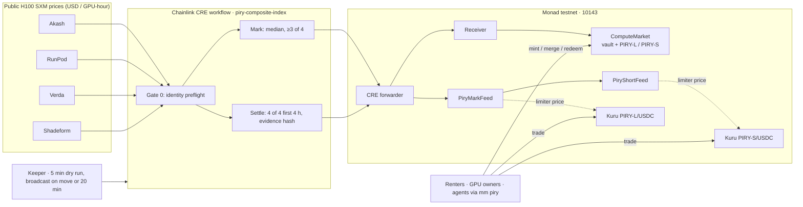

<p align="center"></p>

# Piry

[](https://github.com/Cassxbt/piry/actions/workflows/ci.yml)
[](LICENSE)


[](https://piry.vercel.app)

**A hedge that can't liquidate you.** Fully backed, capped claims on the H100 GPU rental price, traded on Kuru's order book and settled by a Chainlink CRE workflow on Monad.

> GPU rent moves every week. Your price to customers doesn't.
> Piry turns that gap into two tokens you can trade.

[▶ Demo](#-demo) · [Problem](#the-problem) · [Settlement gates](#the-settlement-gates) · [Claims you can check](#claims-you-can-check) · [Traction](#traction) · [Remove a sponsor](#remove-a-sponsor-and-piry-stops) · [Sponsors](#how-it-fits-each-sponsor) · [Contracts](#deployed-contracts) · [Verification](#verification) · [Run it](#run-it-yourself) · [Limits](#security-and-limitations)

## ▶ Demo

| | |
|---|---|
| **Live app** (Monad testnet, no wallet needed to judge) | [piry.vercel.app](https://piry.vercel.app) |
| **Pitch** (1:46) | [youtu.be/JdO9Qg8um0k](https://youtu.be/JdO9Qg8um0k) |
| **Technical demo** (2:45) | [youtu.be/Ekf-KVgrEB4](https://youtu.be/Ekf-KVgrEB4) |
| **Chainlink CRE run** (1:57) | [youtu.be/cjkMjYhwLFY](https://youtu.be/cjkMjYhwLFY) |
| **MetaMask Agent Wallet plugin** (2:04) | [youtu.be/lpb43_Q0WWo](https://youtu.be/lpb43_Q0WWo) |
| **Live series settled on schedule** (19 Oct 2026, via CRE, $3.45, all 4 sources) | [`0x8074c194…9a07`](https://testnet.monadscan.com/tx/0x8074c194307d1091d70ffa3fb41c0591588fa934024334f063d7b8e86c9b9a07) · [verify in your browser](https://piry.vercel.app/evidence) |
| **Agent redeemed through MetaMask Agent Wallet** (80 PIRY-L → 38 USDC) | [`0x52e3fb0b…e87b`](https://testnet.monadscan.com/tx/0x52e3fb0b2e4d30b065aac8796eca0796c35185bca3f43781c0630e576d55e87b) |
| **Accepted settlement, fast-demo series** (CRE report, price $2.658755) | [`0x44b935ac…718338`](https://testnet.monadscan.com/tx/0x44b935ac592035426b2cf07ecacf53b5c824e731a9b32f3ac3126ae60d718338) |
| **Refused replay** (receiver rejects `AlreadySettled`) | [`0x66ebd575…42435d`](https://testnet.monadscan.com/tx/0x66ebd575d1441cadfcfe5a29d9f904c8005ab52081080c7405ca3a0e2f42435d) |
| **Agent hedge on Kuru** (51 PIRY-L for $23.65 under a $30 cap) | [`0xdef2a91f…1ffe`](https://testnet.monadscan.com/tx/0xdef2a91f0b8e84440962eb1dc993ba45b6b91fbfd6b82398763a0f777dc81ffe) |
| **Launch thread** (X) | [@Piry_trade](https://x.com/Piry_trade/status/2115447560982626488) |
| **Tracks** | Monad Metropolis · Track 1 Onchain Finance · Kuru New Assets · Chainlink CRE · MetaMask Agent Wallet |

**Team:** cassxbt ([@Cassxbt](https://github.com/Cassxbt)), solo Solidity and full-stack engineer.

> **Maturity, stated up front.** Everything below runs on Monad testnet with test USDC.
> - Contracts, Kuru markets, live index data and the keeper are real.
> - Settlement runs as a Chainlink CRE CLI simulation (`--broadcast`) through Chainlink's mock forwarder into an operator-gated receiver. The strict DON receiver is written and tested but not deployed.
> - The live series **settled on 19 Oct 2026**, 345 s after expiry, through the CRE workflow with all four sources valid ($3.45; PIRY-L paid $0.475, PIRY-S $0.525). Limits are listed in [Security and limitations](#security-and-limitations).

## The problem

An inference startup sells its customers a fixed monthly price, then rents H100s at a rate that moves every week. When rates jump, the margin is gone. GPU owners and lenders against GPU collateral carry the opposite risk.

Two things make that risk hard to hedge today, and they compound:

- **The instruments don't exist at this size.** CME's GPU futures are in extended CFTC review at 730 GPU-hours a contract, and the ICE/Ornn contracts are pending approval. Prediction markets sell binary bets on a price, not protection sized to a bill.
- **The price isn't one number.** On 13 Oct the same H100 SXM hour was $2.69 on RunPod, $2.73 on Akash, $4.087 on Verda and $4.17 across Shadeform's clouds. Any hedge needs an index that doesn't hang on a single vendor, and a settlement that can't be bent by one source flickering.

## What Piry does

One dollar of collateral mints one long claim (PIRY-L) and one short claim (PIRY-S). At expiry the long pays where the **Piry H100 Composite** lands inside a fixed band ($2.50 to $4.50 for the live series), and the short pays the rest:

```text
long  = clamp((index - 2.50) / 2.00, 0, 1) USDC per claim
short = 1 - long
```

- **No leverage, no margin calls, no liquidation.** A buyer's maximum loss is the premium paid.
- **Built for both sides.** Renters buy the long; GPU owners and lenders hold or buy the short.
- **Real price discovery.** Both claims are ERC-20s on their own Kuru order books.
- **Always backed.** Merging a pair returns exactly one collateral unit, before or after settlement.

## The settlement gates

A price reaches the market only if it clears every gate. Each one is enforced in code and tested.

| Gate | Where | What it refuses |
|---|---|---|
| 0. Identity preflight | CRE workflow (`workflow/preflight.ts`) | A config whose market, feed, index id, spec hash, decimals or period differs from what is on chain. Refused before a single fetch. |
| 1. Source validation | CRE workflow (`workflow/composite.ts`) | Wrong units or hardware, out-of-bounds prices ($0.50 to $20), too few providers, oversized or malformed responses. Each failure gets a fixed code in the evidence. |
| 2. Quorum | CRE workflow | Fewer than 3 of 4 valid sources. In the **first 4 hours after expiry, settlement needs all 4**, checked on the observation actually reported. |
| 3. Evidence binding | CRE workflow + contracts | Every report carries the keccak256 of the canonical source data. Settlement reports also bind chain, market, index id, spec hash and period. |
| 4. Contract checks | `ComputeMarket` | Wrong destination, stale or future-dated reports, zero evidence, early settlement, and any second settlement (`AlreadySettled`). |
| 5. Liveness backstop | `ComputeMarket.settleFallback()` | A stalled oracle. After 7 days anyone can settle at the band midpoint. |

The keeper ([`scripts/keeper.sh`](scripts/keeper.sh), an EC2 systemd timer) checks every 5 minutes with a free dry simulation. It broadcasts only when the index moves, or at least every 20 minutes as a heartbeat, so Kuru's 30-minute price-freshness rule is met without burning gas. It also confirms the accepted on-chain round by evidence hash, and saves the exact source bytes so anyone can re-verify them.

## Claims you can check

Every row is falsifiable: open the link or run the command.

| Claim | Check it |
|---|---|
| The index is the median of 4 live sources ($3.4085 on 13 Oct: 2.69 / 2.73 / 4.087 / 4.17) | `make cre-simulate` (no key, no broadcast) |
| One source dropping moves the index ($3.41 with 4 sources, $2.73 with 3), which is why settlement needs all 4 at first | CRE video at 0:10; `bun test workflow/runtime-test/settlement.test.ts` |
| A full series ran mint → mark → settle → redeem on chain, collateral back to 0 | [Fast-demo lifecycle](#fast-demo-series-full-lifecycle-on-chain) |
| The live series settled on schedule via CRE: the evidence hashes to the on-chain value and the median of its 4 sources reproduces 3450000 | [`0x8074c194…`](https://testnet.monadscan.com/tx/0x8074c194307d1091d70ffa3fb41c0591588fa934024334f063d7b8e86c9b9a07) · [piry.vercel.app/evidence](https://piry.vercel.app/evidence) |
| One asset, one holder, end to end: an agent bought PIRY-L on Kuru, CRE settled the series, and the agent redeemed 80 PIRY-L for 38 USDC through the MetaMask Agent Wallet | buy [`0xdef2a91f…`](https://testnet.monadscan.com/tx/0xdef2a91f0b8e84440962eb1dc993ba45b6b91fbfd6b82398763a0f777dc81ffe) · settle [`0x8074c194…`](https://testnet.monadscan.com/tx/0x8074c194307d1091d70ffa3fb41c0591588fa934024334f063d7b8e86c9b9a07) · redeem [`0x52e3fb0b…`](https://testnet.monadscan.com/tx/0x52e3fb0b2e4d30b065aac8796eca0796c35185bca3f43781c0630e576d55e87b) |
| A replayed settlement is rejected even when the outer tx succeeds | [`0x66ebd575…`](https://testnet.monadscan.com/tx/0x66ebd575d1441cadfcfe5a29d9f904c8005ab52081080c7405ca3a0e2f42435d) (`ReportProcessed.result = false`) |
| The live feed was marked by CRE: 498 rounds through settlement | [`PiryMarkFeed`](https://testnet.monadscan.com/address/0xE4B79233F8ac4804BABfD6bd065aA6596b0EbE5e) `latestRound()` |
| The live market is fully backed: 8,381 test USDC locked against 8,381 claims per side | [`ComputeMarket`](https://testnet.monadscan.com/address/0xe3Aab2F36601cEC8d217DA5497fC3FE00ed22538) `collateralLocked()` |
| Live evidence re-verifies in the browser: hash, quorum, median, spec | [piry.vercel.app/evidence](https://piry.vercel.app/evidence), with files in `app/public/evidence/composite/` |
| An AI agent hedged on Kuru through the MetaMask Agent Wallet, with every receipt checked | approve [`0xa9117b0e…`](https://testnet.monadscan.com/tx/0xa9117b0e299a349ed6f4c88c27d085b64e8702c8a02c63cc3bf5d9746e5a7983) · deposit [`0x27b2645a…`](https://testnet.monadscan.com/tx/0x27b2645a31856a3b7639abb68ea81b944f2c637082e6bdc19d3940d162b3b44d) · swap [`0xdef2a91f…`](https://testnet.monadscan.com/tx/0xdef2a91f0b8e84440962eb1dc993ba45b6b91fbfd6b82398763a0f777dc81ffe) · withdraw [`0xcecc3c4a…`](https://testnet.monadscan.com/tx/0xcecc3c4a34bd3277ddd5e3647fcc7d0e28de5feb2886ba10273e45478f4dc4ed) |
| Everything above is tested | `make verify` · see [Verification](#verification) |

## Traction

- **Two live Kuru markets**, PIRY-L/USDC and PIRY-S/USDC, created by Kuru for Piry's claim tokens. Each is seeded with 8,000 claims of laddered liquidity.
- **51 trades and $681 of volume** on the two books (live count on the [Market](https://piry.vercel.app/market) and [Evidence](https://piry.vercel.app/evidence) pages). This includes 46 stress-test trades at 28 different sizes, real wallet trades through the app, and two MetaMask Agent Wallet hedges.
- **498 CRE marks** published on chain by the keeper, which Kuru's withdrawal limiter reads to price the claims.
- **Open to anyone today:** a faucet gives any wallet 100 test USDC, and three funded judge wallets are ready.

**Next:**
1. ~~Settle the live series on 19 Oct with full quorum.~~ Done: settled via CRE, all 4 sources valid. Seeded Kuru orders were cancelled after settlement.
2. Run weekly H100 series, then H200 and B200, with a period-average (TWAP) option for real bills.
3. Deploy on a Chainlink DON with the strict receiver.
4. Pilot on mainnet with one GPU renter and one GPU owner or lender as natural counterparties, plus a designated maker quoting both books.

## Remove a sponsor and Piry stops

| Remove | What breaks |
|---|---|
| **Chainlink CRE** | No price ever reaches the chain. Marks and settlement are produced only by the workflow, and the contracts accept reports only through the CRE forwarder. There is no admin price setter. Without CRE the feed goes stale, Kuru stops moving the claims, and the only exit is the 7-day midpoint fallback. |
| **Kuru** | No market. A renter could not buy just the long; they would have to mint both legs and find someone to take the short. There would be no price discovery between expiries, no way to unwind early, and no exchange relying on Piry's feed for custody. |
| **MetaMask Agent Wallet** | The agent path stops. `mm piry` holds no key and has no other way to sign, so an agent could quote but not hedge. |
| **Monad** | The cadence stops making sense. Every mark is a transaction (498 on the live series) and every fill settles on an on-chain order book. A 5-minute oracle and per-trade settlement are only cheap on a fast, low-fee chain. |

## How it fits each sponsor

### Kuru: a new asset class on the order book

| Requirement | Piry |
|---|---|
| New tradable market | Capped GPU-price claims: the first compute-price asset on Kuru, in two books |
| Issuance, redemption, settlement | Open minting at exactly $1 per pair, exact merge, CRE settlement, permissionless redemption, 7-day fallback |
| Exchange integration | Kuru's withdrawal limiter prices PIRY-L/S from Piry's AggregatorV3 feeds (`PiryMarkFeed`, `PiryShortFeed`) through Kuru adapters |
| Liquidity strategy | Seeded books now. Open minting lets any maker create inventory at $1 per pair; designated maker plus natural long and short counterparties for the pilot |

| Item | Address or tx |
|---|---|
| PIRY-L/USDC market | [`0xe2393d5f…db1a`](https://testnet.monadscan.com/address/0xe2393d5f15523931e59f340cffebcde30fa7db1a) (created [`0x36d3b9c3…`](https://testnet.monadscan.com/tx/0x36d3b9c38e04892e39dd90ee7e2c5cff81d96f8a8d50916e8a106aa03898c5fb)) |
| PIRY-S/USDC market | [`0xd93db02c…f193`](https://testnet.monadscan.com/address/0xd93db02c88d645e669a3965cd46e72cca137f193) (created [`0x13f5f46e…`](https://testnet.monadscan.com/tx/0x13f5f46ef7cdce9a15d8534449e0f471b6738a49712dc2959e690f42cab9a976)) |
| Kuru V2 Router / AccountCore | [`0xf75A75…`](https://testnet.monadscan.com/address/0xf75A7529b83941e001d7D9bc113A73C92112947E) / [`0xdbaaDe…`](https://testnet.monadscan.com/address/0xdbaaDe7B42c95399bb1E9614D51B5B9e2cf78038) |
| Seeding: mint 8,000 pairs | [`0x8baac099…`](https://testnet.monadscan.com/tx/0x8baac09956e177cb73531eea9680b9794497442a468b333ad4b654b9abed254c) |
| Seeding: post orders PIRY-L / PIRY-S | [`0xb075423c…`](https://testnet.monadscan.com/tx/0xb075423c9858c9648e5f97a00c46383ef0229a6aec7d99b49add0c1f51efe6ae) / [`0x1d5527f9…`](https://testnet.monadscan.com/tx/0x1d5527f9c3ed7d7d81618fbab30ab89e1c582a82ea56c25b2496efbbc0d81160) |

Market parameters: tick 0.0001, minimum order 1 USDC, taker fee 0.07%, maker fee 0.04%.

### Chainlink CRE: the only path for prices onto the chain

| Requirement | Piry |
|---|---|
| Blockchain plus external data | 4 public HTTP APIs into Monad testnet, through CRE's HTTP capability with median consensus |
| Successful simulation | `make cre-simulate` reproduces it with no key; the keeper runs `cre workflow simulate --broadcast` live every 5 minutes |
| Meaningful orchestration | Both the mark feed (read by Kuru) and the settlement are produced only by the workflow; there is no admin price setter |

| Item | Detail |
|---|---|
| Workflow | `piry-composite-index` ([`workflow/`](workflow/)): settlement handler (trigger 0) and mark handler (trigger 1) sharing one validation and encoding path |
| Delivery | `--broadcast` through the CRE mock forwarder [`0xB9F79d…eAd192`](https://testnet.monadscan.com/address/0xB9F79d863261869B234c481D1f9A7af84AeAd192) into `SimulationSettlementReceiver` |
| Production design | `SettlementReceiver` (immutable forwarder, workflow id, 64-byte metadata check), tested and ready for a DON |

### MetaMask Agent Wallet: an agent hedges its own compute bill

[`plugins/metamask-piry/`](plugins/metamask-piry/README.md) adds `mm piry quote | hedge | position | unwind | redeem`. The agent skill is at [`skills/piry/SKILL.md`](plugins/metamask-piry/skills/piry/SKILL.md).

- **No keys in the plugin.** Every write goes through the Agent Wallet executor with a readable intent.
- **Preview first.** `hedge` without `--max-premium` only previews; with it, the premium is a hard cap.
- **Refuses before signing:** orders below Kuru's minimum (`BELOW_MIN_NOTIONAL`), stale prices (preflight against Kuru's limiter), unverified books and settled series.
- **Checks every step.** A step counts only on a confirmed receipt, and a failed step stops everything after it. After each run, wallet and Kuru balances are reconciled into actual coverage, spend and leftovers.
- **Real run (13 Oct):** `mm piry hedge --gpu-hours 40 --max-premium 30` returned HEDGED: 51 PIRY-L for 23.65 USDC, 0 unspent.
- **Guard boundary as observed:** Guard policy changes need the human's email code. On Monad testnet the allowlist and outflow limit did not block transfers in our test, so the plugin enforces its own caps.

## Deployed contracts

Monad testnet (chain 10143), explorer [testnet.monadscan.com](https://testnet.monadscan.com). Machine-readable: [`deployments/monad-testnet.public.json`](deployments/monad-testnet.public.json).

**Live series, Piry H100 Composite, settled 2026-10-19 via CRE at $3.45.** Band $2.50 to $4.50, 6 decimals, max report age 6 h, fallback delay 7 days, collateral Kuru Test USDC.

| Contract | Address | Deploy tx |
|---|---|---|
| `ComputeMarket` | [`0xe3Aab2…d22538`](https://testnet.monadscan.com/address/0xe3Aab2F36601cEC8d217DA5497fC3FE00ed22538) | [`0xd0896578…`](https://testnet.monadscan.com/tx/0xd08965787f8faec563ab4d31ebb50884503300dc468fcdb1a0e2bd7a79aa71ce) |
| `SimulationSettlementReceiver` | [`0x6B1556…29a3A1`](https://testnet.monadscan.com/address/0x6B15565bFC329edEC5ca2BAE96fB792C0429a3A1) | [`0x723c3154…`](https://testnet.monadscan.com/tx/0x723c31546d9456686425581e433bd7a8321ae163837bcdc9894d94dd9f456dc5) |
| `PiryMarkFeed` (long value, AggregatorV3) | [`0xE4B792…0EbE5e`](https://testnet.monadscan.com/address/0xE4B79233F8ac4804BABfD6bd065aA6596b0EbE5e) | [`0xab2f28d3…`](https://testnet.monadscan.com/tx/0xab2f28d36302d6e1cc68586558fd9daaa44baa990cb25b81c5eef808a412f43f) |
| `PiryShortFeed` (1 − long, AggregatorV3) | [`0xd97bd7…0e2f80`](https://testnet.monadscan.com/address/0xd97bd777304bbf14d713c5498951da52d50e2f80) | [`0x6325878e…`](https://testnet.monadscan.com/tx/0x6325878ea606da63fd570c4a1baf6645a199069fa463ea6bb713295ab74094fc) |
| PIRY-L / PIRY-S claims | [`0x7D4B13…`](https://testnet.monadscan.com/address/0x7D4B1319648B1f2478495Dcce10313Cd045Ef997) / [`0xF3ACA8…`](https://testnet.monadscan.com/address/0xF3ACA854B4e0626CDedd391eC1396DBde6820d48) | created by `ComputeMarket` |
| Faucet (100 test USDC per wallet) | [`0x6ee33f…c5d6`](https://testnet.monadscan.com/address/0x6ee33fc6c23269463b7c824a34fea49acaa0c5d6) | |

### Fast-demo series: full lifecycle on chain

A synthetic-index series with 60-second slots, band $2 to $4, collateral `PiryTestUSD`.

| Step | Transaction |
|---|---|
| Mint 1,000 pairs | [`0x8c1c5446…`](https://testnet.monadscan.com/tx/0x8c1c5446bf088b10d0b0b7015ed8f04b2879873096255ff6be7b6bde79d6e85d) |
| CRE mark: index 2.7436 → long 0.3718 | [`0x818bb3d6…`](https://testnet.monadscan.com/tx/0x818bb3d66767f4c47a160e068d934b405e1e6cf9c7b001a11ff1b80993e263a5) |
| Duplicate-slot data | **Refused** by the workflow before any write; `settled()` stayed false |
| CRE settlement at $2.658755 | [`0x44b935ac…`](https://testnet.monadscan.com/tx/0x44b935ac592035426b2cf07ecacf53b5c824e731a9b32f3ac3126ae60d718338) |
| Replay | **Rejected** (`AlreadySettled`): [`0x66ebd575…`](https://testnet.monadscan.com/tx/0x66ebd575d1441cadfcfe5a29d9f904c8005ab52081080c7405ca3a0e2f42435d) |
| Redeem 1,000 long → 329.3775 | [`0x829cf643…`](https://testnet.monadscan.com/tx/0x829cf6434f441258da3799bfcdf6ecbe621178bdd3e1f9bc4685e38d8dbe9097) |
| Redeem 1,000 short → 670.6225 | [`0xe693ee80…`](https://testnet.monadscan.com/tx/0xe693ee80331f3689355fcd8db966af3e5e22404cca6e798069111bdc4e76b84f) |

After full redemption `collateralLocked` was 0.

## Architecture



## Piry H100 Composite

| Source | Endpoint | Rule |
|---|---|---|
| Akash | `console-api.akash.network/v1/gpu-prices` | H100 80Gi SXM5, `weightedAverage`, at least 2 providers |
| RunPod | `api.runpod.io/graphql` | `NVIDIA H100 80GB HBM3`, 1 GPU, on-demand |
| Verda | `api.verda.com/v1/instance-types` | `1x H100 SXM5 80GB`, on-demand |
| Shadeform | `api.shadeform.ai/v1/instances/types` | H100 SXM5, 1 GPU, at least 4 clouds, Verda excluded to avoid double counting |

Endpoints and rules are bound into the series `specHash`, so config cannot redirect a source.
- **Median:** with 4 valid sources it is the floored mean of the middle two; with 3 it is the middle one.
- **Evidence:** the canonical JSON of the four entries, methodology (`composite-median-v1`), `specHash` and snapshot time. It is hashed on chain with every report and published for browser verification.
- **Settlement:** one snapshot taken when settlement executes, up to 24 hours after expiry, under the full-quorum rule.

## Verification

All suites run in [CI](https://github.com/Cassxbt/piry/actions/workflows/ci.yml) on every push: 1,073 tests.

| Suite | Result (13–14 Oct 2026) |
|---|---|
| Solidity (Foundry, incl. fuzz and adversarial-token suites) | 136 passed |
| CRE workflow, Node runner | 251 passed |
| CRE workflow, Bun runtime (incl. 23 keeper tests on stubbed `cre`/`cast`) | 184 passed |
| MetaMask plugin | 166 passed, 4 live tests skipped |
| App (vitest), also from a tracked-files-only copy | 327 passed |
| Kuru preflight checker (Python) | 9 passed |

`make settlement-proof` runs validated data → report → receiver → settlement → redemption on a local Anvil, including duplicate data, a wrong-chain report and replay. A green CLI run is never treated as settlement; outcomes are read from events and contract state.

An independent four-reviewer adversarial review (13 Oct) found no permissionless drain or over-redemption. Every material finding was fixed or is disclosed below.

## Run it yourself

Requires Node.js 22, Bun, Python 3, Make and Foundry.

```bash
git clone https://github.com/Cassxbt/piry && cd piry
npm ci --ignore-scripts && forge build
make verify          # offline, no keys
make cre-simulate    # live sources, no key, no broadcast (needs CRE CLI 1.38.0 + cre login)
cd app && npm ci && npm run dev   # judge app; a clean clone builds from deployments/monad-testnet.public.json
```

Plugin (read-only works before login):

```bash
cd plugins/metamask-piry && npm ci && npm run build
mm config set experimentalPlugins true && mm config set experimentalAllowUnverifiedInstalls true
mm plugins install "file:$PWD" --accept-permissions
mm piry quote --gpu-hours 40
```

| Variable | Use |
|---|---|
| `DEPLOYER_PRIVATE_KEY` | Testnet writes only (`deploy-testnet`, `seed-kuru`, `test-trades`) |
| `CRE_ETH_PRIVATE_KEY` | `cre workflow simulate --broadcast` only |
| `CRE_API_KEY` | Non-interactive CRE auth (alternative to `cre login`) |
| `MONAD_TESTNET_RPC`, `PIRY_RPC_URL`, `PIRY_KURU_MARKET`, `PIRY_KURU_SHORT_MARKET` | Optional overrides |

Never commit `.env*` files; the repository ignores them.

| Path | Contents |
|---|---|
| `contracts/` | `ComputeMarket`, `ClaimToken`, `PayoutMath`, receivers, `PiryMarkFeed`, `PiryShortFeed`, `PiryFaucet`, `PiryTestUSD` |
| `workflow/` | CRE workflow: preflight, composite index, mark and settlement handlers, delivery |
| `scripts/` | `keeper.sh`, `deploy.ts`, `seed-kuru.ts`, `test-trades.ts`, `settlement-proof.ts`, `preflight.py` |
| `plugins/metamask-piry/` | MetaMask Agent Wallet plugin and agent skill |
| `app/` | Judge app (Vite + React + wagmi) |

## Security and limitations

- **Testnet prototype, unaudited.** Test tokens only.
- **Operator-gated settlement.** On the live series the receiver accepts the CRE forwarder plus the operator (`tx.origin`), so the operator must never call an untrusted contract. The strict `SettlementReceiver` is the production design.
- **Fallback is a liveness tool, not fair value.** After 7 days `settleFallback()` settles at the band midpoint. The first settlement wins, and a holder on the losing side has a reason to withhold a report until then.
- **Settlement timing.** A snapshot when settlement executes, up to 24 h after expiry; not a monthly average (TWAP is on the roadmap).
- **Data trust.** Checks cover shape, units and bounds, not truth. The sources are public, unlicensed endpoints. Quorum counts providers that returned a price, not rentable capacity, and timestamps are fetch times. Production swaps in licensed or provider-signed data.
- **Basis risk.** The index tracks listed on-demand prices, so a hedger's own bill can differ. Payouts are capped at the band.
- **Liquidity.** Both books are seeded by Piry and still thin; a designated maker is part of the pilot plan.
- **Rounding.** Merging a pair is exact. Separate leg redemptions round down and can leave dust.
- **Dependencies** keep their licenses: OpenZeppelin (MIT), CRE SDK (BUSL-1.1).

## AI disclosure

Built with AI coding assistants under human direction and review. Tests were written before non-trivial logic, with mutation checks on the critical paths, and an independent AI review panel audited the build.

## License

MIT
